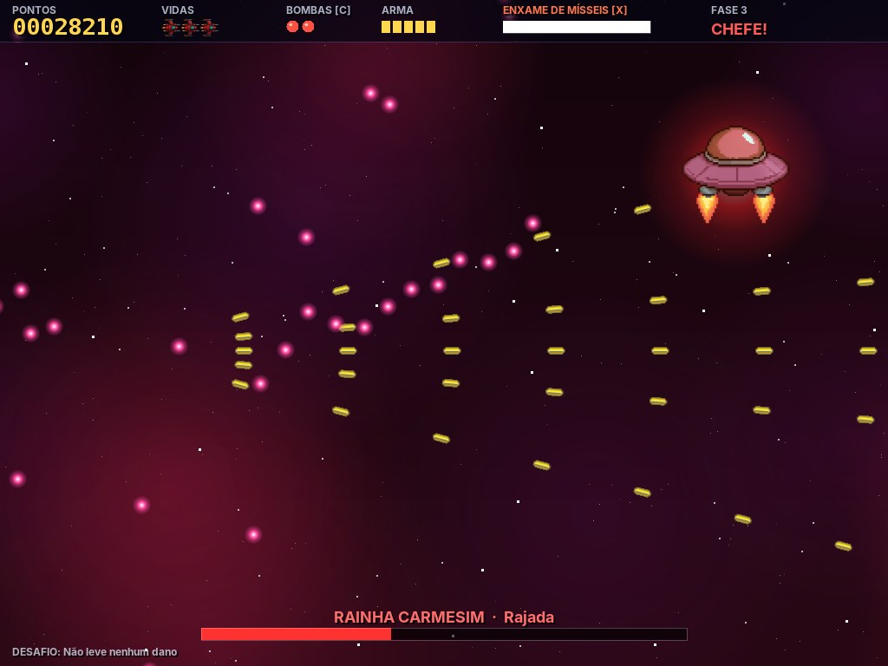
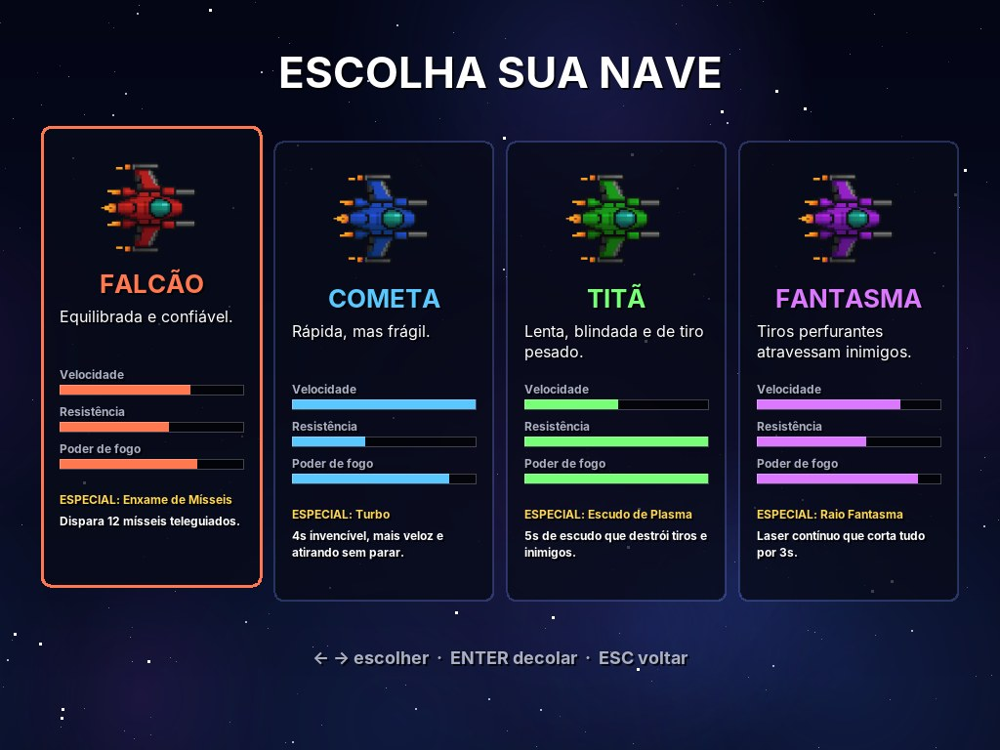

# 🚀 Navinha Espacial

Jogo de navinha 2D em Java (Swing/AWT): escolha sua nave, atravesse 5 fases, cumpra desafios, derrote os chefes e tente entrar no ranking.



## 📱 Versão web (celular e PC)

A pasta `docs/` tem o jogo inteiro em HTML/JavaScript, com instalação como app (PWA):

- **Celular:** deslize o dedo para mover — a nave atira enquanto o dedo está na tela. Botões ★ (especial), 💣 (bomba) e ❚❚ (pausa) no canto.
- **PC:** mesmos controles do teclado da versão Java.
- **Instalar:** botão "Baixar app" no menu (Android/Chrome) ou Compartilhar → Adicionar à Tela de Início (iPhone). Depois de instalado, funciona sem internet.
- **Atualizar:** ao publicar uma versão nova, o jogo mostra "Nova versão disponível — Atualizar".

Para publicar: em *Settings → Pages* do repositório, escolha a branch `main` e a pasta `/docs`. O jogo fica em `https://rafajames.github.io/Navinha/`.
A cada atualização, aumente o número de `VERSAO` em `docs/sw.js` (e em `docs/game.js`) para os aparelhos receberem o aviso.

## ▶️ Como rodar

**Mais fácil:** com Java 8 ou superior instalado, dê dois cliques em `Navinha.jar` ou rode:

```bash
java -jar Navinha.jar
```

**Compilando o código:**

```bash
javac -encoding UTF-8 -d bin src/navinha/*.java
cp -r src/res bin/
java -cp bin navinha.Main
```

Os recordes ficam em `records.txt` e o progresso (naves desbloqueadas) em `progresso.properties`, na pasta de onde o jogo foi aberto.

## 🎮 Controles

| Tecla | Ação |
|---|---|
| Setas ou WASD | Mover |
| Espaço (segure) | Atirar |
| X | Poder especial (quando a barra encher) |
| C | Bomba — limpa os tiros e destrói os inimigos da tela |
| P ou Esc | Pausar |
| M | Liga/desliga o som |

## 🛸 Naves



| Nave | Estilo | Especial |
|---|---|---|
| **Falcão** | Equilibrada | **Enxame de Mísseis** — 12 mísseis teleguiados |
| **Cometa** | Rápida e frágil | **Turbo** — 4 s invencível, mais veloz, atirando sem parar |
| **Titã** | Lenta, 5 vidas, tiro pesado, começa com escudo | **Escudo de Plasma** — 5 s de escudo que destrói tiros e inimigos |
| **Fantasma** | Tiros perfurantes | **Raio Fantasma** — laser contínuo por 3 s |

🔒 **Titã**: derrote o chefe da Fase 2. 🔒 **Fantasma**: complete 3 desafios de fase (somando todas as partidas).

## ⚡ Power-ups

| Item | Efeito |
|---|---|
| **P** Arma+ | Sobe o nível da arma (1 a 5: tiro duplo, triplo, leque…) |
| **R** Tiro rápido | Dobra a cadência por 8 s |
| **E** Escudo | Aguenta 1 golpe |
| **S** Energia | +50% na barra do especial |
| **B** Bomba | +1 bomba |
| **+** Vida | +1 vida |

Os itens são atraídos quando a nave chega perto. A cada 15 abates sempre cai um item.

## 👾 Inimigos

- **Disco** — voa reto (às vezes em formação em V)
- **Zigue-Zague** — ondula, às vezes em fila como uma cobra
- **Atirador** — para na tela e mira em você
- **Kamikaze** — persegue a sua nave
- **Encouraçado** — resistente, dispara leques de tiros
- **Asteroide** — se parte em dois fragmentos

## 🌌 Fases e chefes

| Fase | Cenário | Desafio bônus | Chefe |
|---|---|---|---|
| 1 | Cinturão de Órion | Combo de 15 | Nave-Mãe Ômega |
| 2 | Campo de Asteroides | Destruir 12 asteroides | Devorador de Rochas |
| 3 | Nebulosa Carmesim | Não levar dano | Rainha Carmesim |
| 4 | Fronteira Sombria | Não usar bombas | Sentinela Sombria |
| 5 | Núcleo Alienígena | Derrotar o chefe em 75 s | Imperador Zorg |

Cada fase tem uma meta de abates; ao cumpri-la o chefe aparece. Os chefes alternam ataques (leque, espiral, rajada, anel, muralha com brecha, invocação de lacaios) e entram em **modo fúria** com metade da vida.

Depois de vencer o Imperador Zorg dá para continuar no **Modo Infinito**: as fases recomeçam em ciclos, mais rápidas, com chefes mais resistentes e pontuação multiplicada.

## 🏆 Pontuação

- Abates seguidos formam **combo**; a cada 10 o multiplicador sobe (até x5).
- Bônus por chefe derrotado, desafio cumprido e vidas restantes ao fim da fase.
- Levar dano tira 1 vida, 1 nível de arma e zera o combo.
- Top 10 salvo com nome, nave e fase alcançada.

## 📁 Estrutura

```
src/navinha/
├── Main.java         janela
├── Jogo.java         loop (60 FPS fixo), estados, regras e colisões
├── Hud.java          HUD e todas as telas (menu, seleção, pausa, fim de jogo…)
├── Player.java       nave do jogador, armas e especiais
├── NaveTipo.java     as 4 naves e seus atributos
├── Inimigo.java      comportamento dos inimigos  ·  InimigoTipo.java
├── Chefe.java        chefes e padrões de ataque
├── Fase.java         configuração das 5 fases e desafios
├── PowerUp.java      itens
├── Tiro.java         tiros, mísseis e esferas inimigas
├── Efeitos.java      explosões, partículas e textos flutuantes
├── Fundo.java        céu com nebulosas e estrelas em paralaxe
├── Sprites.java      carregamento, escala e recoloração das imagens
├── Som.java          efeitos e música
├── Dados.java        recordes e progresso
└── Input.java        teclado
src/res/              imagens e sons
```

## 🧠 Autor

**Jamerson Rafael da Silva Viana** · 📧 jamersonrafael.sv@gmail.com · Projeto iniciado em 2025

Feito com 💙 em Java.
